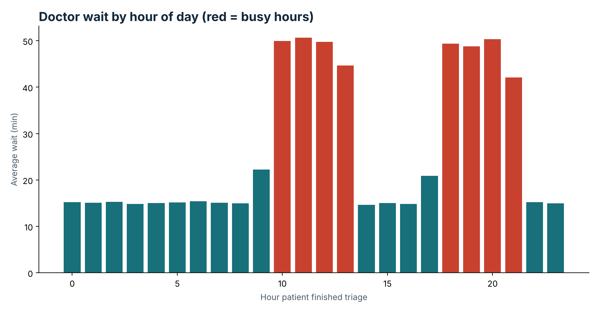
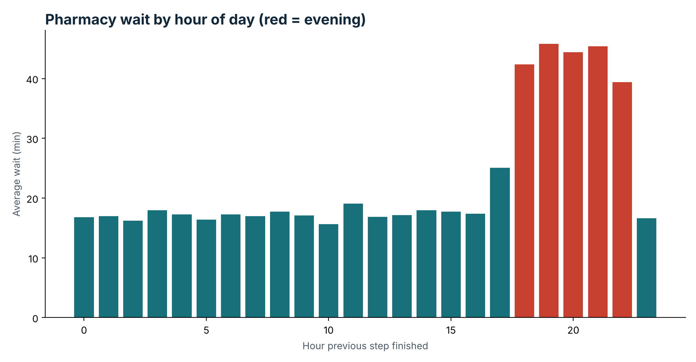

# CareFlow final results

All numbers come from the simulated event log (10,000 patients, 68,440 events). They show that the pipeline works, not facts about a real hospital.

## Data quality
- validate_data.py: 9 of 9 checks pass.
- dbt test: 11 tests pass on the BigQuery views.
- dbt and PM4Py both count 965 loop-back patients.

## What the pipeline found
| Planted problem | Result in the data |
|---|---|
| 40% X-Ray to Triage loop-back | 965 of 2,377 X-Ray patients (40.6%) |
| Busy-hour doctor waits | 48.5 min busy vs 17.8 min other hours |
| Slow evening pharmacy | 44.5 min evening vs 18.2 min other times |

## Conformance
- 9,035 patients (90.35%) follow the ideal path; 965 do not.
- Non-compliant share by condition: Fracture 35.3%, Chest pain 11.5%, Stomach pain 8.9%, Fever 4.2%, Minor illness 1.9%.

## Charts

